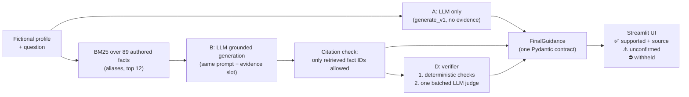
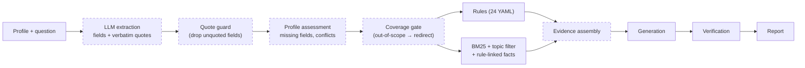
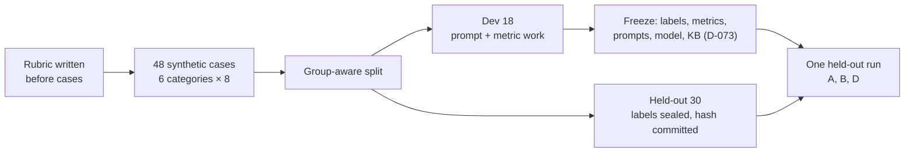

<div align="center">

<h1>BTO Buddy</h1>

<p><b>An evidence-grounded preparation assistant for first-time BTO flat applicants</b><br/>
Public-sector AI prototype · fictional applicant profiles only · not an official eligibility assessment</p>

<p>
<a href="#1-run-it-with-docker">Run it</a> ·
<a href="#2-at-a-glance-built-vs-designed">Built vs designed</a> ·
<a href="#4-how-it-works">Architecture</a> ·
<a href="#5-data-provenance-licensing-and-privacy">Data</a> ·
<a href="#6-model-selection">Model</a> ·
<a href="#7-evaluation-method">Evaluation</a> ·
<a href="#8-results">Results</a> ·
<a href="#10-limitations">Limitations</a> ·
<a href="#15-ai-coding-agent-usage">AI usage</a>
</p>

<p><b>Demo video (3–5 min):</b> <a href="https://tinyurl.com/bto-buddy-demo">https://tinyurl.com/bto-buddy-demo</a></p>

</div>

---

## 1. Run it with Docker

You need two things: **Docker** (Docker Desktop on macOS/Windows, Docker Engine on Linux) and
a **GroqCloud API key**. The key is free: sign up at <https://console.groq.com>, open
*API Keys*, then *Create API Key*. It starts with `gsk_`.

**Step 1: check that Docker is running.** This should print version information, not an
error:

```bash
docker info --format '{{.ServerVersion}}'
```

**Step 2: get the code.**

```bash
git clone <this repository URL> bto-buddy
cd bto-buddy
```

**Step 3: create your configuration file and add the key.**

```bash
cp .env.example .env          # Windows PowerShell: Copy-Item .env.example .env
```

Open `.env` in any text editor and fill in the first line. **Do not add quotes or spaces**:

```
BTO_BUDDY_LLM_API_KEY=gsk_yourkeyhere
```

Leave the other lines blank. The base URL and model default to Groq and
`openai/gpt-oss-120b`. `.env` is Git-ignored and never enters the image.

**Step 4: build the image.** This takes a few minutes the first time and uses about 850 MB of
disk.

```bash
docker build -t bto-buddy .
```

**Step 5: run it.**

```bash
docker run --rm -p 8501:8501 --env-file .env bto-buddy
```

**Step 6: open <http://localhost:8501>.** Pick a demo example from the drop-down, keep
*D: grounded + claim verification* selected and click **Get preparation guidance**. You
should see a summary, the published requirements with ✅/⚠️ markers and source links, the
preparation steps, any missing information, and a footer with the model, latency and token
count. A D answer takes about 5–20 s. Stop the app with `Ctrl+C`.

Optional health check from a second terminal: `curl -f http://localhost:8501/_stcore/health`
prints `ok`.

<details>
<summary><b>Troubleshooting</b></summary>

| What you see | Cause | Fix |
|---|---|---|
| Red banner "No LLM API key is configured" at the top | `.env` not passed, empty, or edited after the container started | Check the key line in `.env`, stop the container (`Ctrl+C`) and run step 5 again with `--env-file .env` |
| "No guidance could be produced" with an error mentioning 401 or an invalid key | The key is wrong or revoked | Create a new key in the Groq console and put it in `.env` |
| "No guidance could be produced: rate_limit … 429" | Groq free-tier limit: 8K tokens/minute, **200K tokens/day** | Wait a minute (per-minute limit) or until the next day (daily limit). See §10 |
| `Bind for 0.0.0.0:8501 failed: port is already allocated` | Something else uses port 8501 | Use `-p 8502:8501` and open <http://localhost:8502> |
| `Cannot connect to the Docker daemon` | Docker is not running | Start Docker Desktop and repeat step 1 |

</details>

**What the container contains:** the app and the four tracked, reviewer-facing data files
(`data/policy_facts.jsonl`, `policy_rules.yaml`, `sources_manifest.json`,
`visual_resources.json`). It runs as a non-root user, with a built-in health check. It
**never needs** my private source snapshots (`data/private_corpus/`), the sealed held-out
labels, or any file other than `.env`.

**Tested:** on 2026-10-29 I built the image with `--no-cache` from a fresh `git clone`
(macOS on Apple Silicon, Docker 29.9.2), with no private files present. With
`.env.example` unchanged, the health check returned `ok` and the page showed the missing-key
banner. With a key, live A, B and D answers rendered inside the container. **I have not
tested** Linux or Windows hosts. The base image (`python:3.12-slim`) is multi-architecture.

### 1.1 Local development (no Docker)

Requires [uv](https://docs.astral.sh/uv/) 0.13.6 and Python ≥ 3.12.

```bash
uv sync                                    # exact versions from uv.lock
uv run pytest                              # offline tests, no API key needed
uv run ruff check . && uv run mypy         # lint + strict typing
uv run streamlit run src/bto_buddy/app.py  # reads ./.env
```

### 1.2 What is reproducible: offline vs live

| Kind | Commands | Needs | Reproduces |
|---|---|---|---|
| **Offline, deterministic** | `pytest`, `ruff`, `mypy`, KB load, BM25 retrieval, `evaluation.run check / sheet / diagnostics`, `evaluation.metrics` on the saved dev runs | Only `uv sync` | **Exactly.** `diagnostics_dev.json` and `metrics_dev.json` are recomputed byte-for-byte from the saved predictions |
| **Live, non-deterministic** | the app, `evaluation.run run`, `evaluation.run verify` | API key, network, Groq quota | **Not exactly.** Provider-side variation remains even at temperature 0. A re-run is a new experiment with a new run ID and never overwrites the saved record |

```bash
# Offline: recompute my reported dev metrics from the saved runs (no key)
uv run python -m evaluation.run diagnostics 20261028T203350Z-A-dev 20261028T205255Z-B-dev 20261028T211724Z-D-dev
uv run python -m evaluation.metrics 20261028T203350Z-A-dev 20261028T205255Z-B-dev 20261028T211724Z-D-dev
git diff --exit-code evaluation/results/    # no diff = reproduced

# Live: new runs (key needed; results vary)
uv run python -m evaluation.run run --config A --split dev
uv run python -m evaluation.run verify 20261028T205255Z-B-dev   # D re-judged on B's saved answers
```

**How much live re-runs vary.** I measured this from a clean clone on 2026-10-29. `verify`
on the saved B answers reused identical pre-verification outputs (18/18 hashes) and gave the
same verifier verdict on **46 of 49 claims**. Re-running A gave the same counts of missing
fields, conflicts and out-of-scope reasons in 17 of 18 cases, but identical summary text in
only 5 of 18. All reported numbers come from the saved runs.

**What cannot be reproduced from this repository:**
- **Source capture and fact authoring.** `scripts/corpus.py` and `scripts/snapshots.py` need
  my HDB snapshots, which I do not redistribute (§5). The pages can be recaptured by hand
  (`docs/data_sources.md` §7), but they may have changed since 28 Oct 2026. The tracked
  `policy_facts.jsonl` is the reproducible starting point. Without snapshots, both scripts
  stop with a message and change nothing.
- **Held-out metrics.** The labels are sealed and only their SHA-256 is tracked (D-064). The
  saved held-out predictions are in the repo.

<details>
<summary><b>Clean-machine smoke test (8 steps, all passed on 2026-10-29)</b></summary>

From a fresh clone with no `.env`, no `data/private_corpus/` and no `references/`:

1. `uv lock --check && uv sync`: 61 packages from `uv.lock`.
2. `uv run pytest`: all pass. One test skips because the held-out labels are absent.
3. `uv run ruff check . && uv run ruff format --check . && uv run mypy`: clean.
4. `uv run python -c "from bto_buddy.policy import load_kb; print(load_kb().kb_version)"` prints `kb-2026-10-28.1`.
5. The offline recomputation above leaves `git diff` empty.
6. `cp .env.example .env && docker build -t bto-buddy . && docker run --rm -p 8501:8501 --env-file .env bto-buddy`.
7. `curl -f http://localhost:8501/_stcore/health` returns `ok`, and the page shows the missing-key banner.
8. Add the key, restart, choose a preset and click the button. An answer with sources appears.

</details>

---

## 2. At a glance: built vs designed

I designed a four-configuration ablation (A → B → C → D). Under time pressure I built and
evaluated **A, B and D**, but not C.

| Component | Status | Evidence |
|---|---|---|
| **Knowledge base:** 89 independently authored facts, each with source URL, section, retrieval date and validation status (53 `verified`, 36 `snapshot_checked`) | ✅ Built, frozen (`kb-2026-10-28.1`) | `data/policy_facts.jsonl`, `data/corpus/corpus_version.json` |
| **Rule registry:** 24 declarative YAML rules, three-valued logic, no `eval` | ✅ Built and unit-tested · ❌ **not wired into answers** | `data/policy_rules.yaml`, `src/bto_buddy/policy.py`, `tests/test_rules.py` |
| **A: direct LLM baseline** | ✅ Built, evaluated (dev + held-out) | `pipeline.run_direct` |
| **B: BM25 retrieval + grounded generation**, citations restricted to retrieved facts | ✅ Built, evaluated (dev; held-out 7/30, see §8.2) | `retrieval.py`, `pipeline.run_rag` |
| **C: LLM profile extraction → coverage gate → rules ∥ retrieval** | ❌ Designed, **not built** (D-069) | `docs/architecture.md` §3 |
| **D: claim verifier** (deterministic checks + one batched LLM judge), **applied to B, not C** | ✅ Built, evaluated (dev; held-out judge rate-limited) | `verification.py`, `pipeline.run_verified` (D-071) |
| **Streamlit app:** A/B/D toggle, 3 demo presets, verified/unconfirmed/withheld display, source links | ✅ Built, tested in Docker | `src/bto_buddy/app.py` |
| **Benchmark:** 48 synthetic cases (18 dev / 30 held-out), frozen | ✅ | `evaluation/benchmark/`, `docs/evaluation_benchmark.md` |
| **Evaluation harness:** runner, blinded scoring sheet, diagnostics, automated metrics with paired statistics | ✅ | `evaluation/run.py`, `evaluation/metrics.py` |
| **Blind human scoring** of the primary metrics (critical errors, coverage, actionability) | ❌ Not done | `evaluation/results/scoring/` holds the blinded, unscored answer sheet |
| **Full held-out run** | ⚠️ A complete; B and D 7/30 (free-tier daily token cap) | §8.2 |

---

## 3. Problem and objective

**In one sentence:** I identified a real public-service information challenge, built an AI
assistant that turns complex published requirements into personalised preparation guidance,
and evaluated whether evidence grounding and claim verification make it more reliable than a
model answering on its own.

**The problem.** First-time BTO applicants work through a chain of decisions: who counts as
their household, whether they meet the applicant conditions, what income and employment
documents the HDB Flat Eligibility (HFE) letter needs, which priority schemes apply, and what
happens if an application fails. The official information exists. The difficulty is working
out **which rules apply to my particular circumstances, and what I still need to find out
before I apply**. Small misunderstandings, such as "the HFE letter lasts a year" or "we must
marry before applying", lead to wasted applications and avoidable enquiries.

**Why existing channels fall short.** HDB's website and chatbot leave most of the navigation
and reading to the applicant:
- Information for one applicant group is **scattered**: across pages, same-page anchors, PDFs
  that open in new tabs, infographics published as images, and YouTube videos. Content meant
  for other groups is shown alongside it.
- Important clauses sit in collapsed sections and are **easy to miss** unless every section
  is expanded and read carefully.
- An applicant can qualify for a scheme **without realising it**, because its conditions sit
  in a different section from the ones they are reading.
- When I gave HDB's chatbot a detailed situation, it retrieved possibly relevant information
  but **mostly redirected me to links** to read myself.

The result is a generic, non-personalised experience that acts more like an information dump
than an applicant-centred service, and that makes home-buying feel tiring.

**What BTO Buddy adds:** a **pre-application preparation layer** that sits before, and never
replaces, the official HFE assessment and application. From a free-text description of a
(fictional) couple and a question, it produces:
- what the published requirements say, each linked to the official HDB page;
- what to prepare;
- what information is missing;
- which details contradict each other;
- what my sources cannot confirm.

The difference is **transparency and preparation, not authority**. It **never** decides
eligibility, calculates grants or estimates ballot chances; it redirects those requests to
official services.

**Stakeholders and potential value.** The direct users are first-time couples; the agency is
HDB. If applicants arrive better prepared, there could be fewer hotline enquiries and fewer
ineligible applications to process. That is a **hypothesis this prototype does not test**;
validating and quantifying it would need user testing.

**Research question:** does grounding one LLM in a small, verified, source-attributed
knowledge base, plus claim verification, reduce critical errors compared with the same
model answering from its own knowledge? My original design also tested structured reasoning
(profile extraction plus deterministic rules, configuration C). I built the rule engine but
not C, so that part of the question is still open (§2).

**Scope (D-008):**

| Tier | Policy areas |
|---|---|
| Core | First-timer couple household composition; broad application requirements; HFE prerequisites, timing and documents; missing applicant information |
| Limited | Priority schemes; non-selection consequences |
| Context only | How the HFE letter relates to grants and loans (explained, never calculated) |
| Excluded | Eligibility decisions, grant/loan calculations, financing, ballot odds, post-purchase conditions, real applicant data |

---

## 4. How it works

### 4.1 As built (A, B, D)



### 4.2 As designed (C), not built



The dashed stages do not exist in code. The rule engine (`RU`) exists and is tested, but no
built configuration calls it.

### 4.3 Design decisions, and why

- **One output contract** (`FinalGuidance`, Pydantic) for every configuration. It always
  carries `missing_profile_fields`, `profile_conflicts`, `evidence_gaps` and
  `out_of_scope_reasons` as separate lists. Claims are tagged `policy_fact`,
  `preparation_step` or `caveat`. Run metadata records the model, prompt version, tokens,
  latency, cost and status. *Why:* configurations can be compared like for like, and the UI
  cannot hide uncertainty.
- **One prompt** (`src/bto_buddy/prompts/generate_v1.md`) with an evidence slot. A gets "no
  sources provided" and B gets the retrieved facts. *Why:* A vs B isolates retrieval.
- **Structured output:** a strict JSON schema derived from the Pydantic models. On a
  validation failure there is one retry that carries the error; after that the request
  **fails closed** and the failure is kept in the results.
- **Citation integrity (B):** a claim may cite only facts that were actually retrieved. A
  policy claim without a citation is shown as "not confirmed by our sources". Missing
  evidence is never presented as proof that a requirement doesn't exist.
- **Verification (D):** checks every `policy_fact` claim and any cited preparation step. The
  judge must find that the cited facts **substantively** state the claim, including numbers,
  conditions and who it applies to. Outcomes: supported → shown with source; contradicted →
  withheld and flagged; insufficient → shown as unconfirmed with no source. Claims are never
  rewritten and nothing is regenerated. If the judge fails, every claim stays unconfirmed
  (fail closed).
- **Retrieval:** BM25 with deterministic tokenisation, accent folding and a small reviewable
  synonym map. One fact is one passage. *Why not embeddings or a vector database:* the
  corpus is 89 short facts; BM25 is deterministic, explainable and needs no extra service
  (D-031). The trade-off is low recall on colloquial questions (§8.1).
- **No agents or orchestration frameworks:** a fixed pipeline with at most 3 LLM calls is
  easier to test, cost and explain (D-030).

---

## 5. Data: provenance, licensing and privacy

| Dataset | What | Provenance | In Git? |
|---|---|---|---|
| Source snapshots (L0/L1) | 5 HDB web pages (S01–S05) and 2 HDB PDFs (S07, S08), captured by hand in a browser on 2026-10-28. Other sources are link-only | `data/sources_manifest.json` (URL, SHA-256, timestamp, rights record per source) | **No.** Private, Git-ignored |
| Policy facts (L2) | 89 **independently authored** paraphrases: 53 `verified` (all critical facts) and 36 `snapshot_checked`. All passed an automated 8-word-overlap check against the sources | `data/policy_facts.jsonl`; method in `docs/data_sources.md` | Yes |
| Rules (L3) | 24 declarative rules citing verified facts only | `data/policy_rules.yaml` | Yes |
| Learning resources | 2 official HFE infographics and 2 videos, **links only**, never used as evidence | `data/visual_resources.json` | Yes |
| Benchmark | 48 **synthetic** couple profiles with labels citing facts and rules | `evaluation/benchmark/` | Dev labels yes; held-out labels sealed (hash only) |

**One frozen knowledge base.** The app, the BM25 index, the rule registry and both
evaluation splits all load the same `data/policy_facts.jsonl` through one loader
(`policy.load_kb()`). Its SHA-256 matches the freeze record in
`data/corpus/corpus_version.json`. The file and the rules are byte-identical in every commit
used for the saved runs. The rules, benchmark manifest and index all report
`kb-2026-10-28.1`. This is enforced by
`tests/test_policy_kb.py::test_one_frozen_kb_for_app_rules_retrieval_and_benchmark`. Note
that the rule registry validates against the KB but does not influence answers (C not built).

**Lawful access:**
- HDB returns HTTP 403 to automated clients. I respected that block: pages were captured by
  hand, with no scraping or spoofing (D-055).
- I excluded the HFE FAQ pages because robots.txt disallows them (D-060).

**Copyright:**
- I keep the snapshots for computational analysis only (Copyright Act 2021 s 244). Only my
  own paraphrases are tracked; no source text is.
- HDB's Terms of Use ask for permission before reuse. This prototype is private and run
  locally; public deployment would need HDB's permission (D-057, disclosed residual risk).
- Facts carry `rights_review: overlap_checked`. My final manual rights read (`cleared`) is
  still pending.

**Privacy:**
- Only fictional profiles are used, and the UI warns against entering real data. User text is
  not logged.
- Runtime calls send the fictional profile and authored facts to Groq, never raw source
  text (D-054).

**Synthetic-data methodology and defence:**
- **Why synthetic:** real applicant data would be personal data under the PDPA and isn't
  needed to test preparation guidance. Real logs would also rarely contain enough examples of
  specific failure modes in a small sample.
- **How:** I wrote the rubric before the cases (D-063). There are 48 cases in 6 categories
  × 8: standard, missing information, policy exception, misconception, conflicting details,
  out of scope. Every label cites the facts and rules it rests on. The rule engine was used
  only to cross-check labels.
- **Leakage controls:** the split (18 dev / 30 held-out) is group-aware, so near-duplicate
  families stay on one side, and a cross-split Jaccard check (≥ 0.6) found nothing. Held-out
  labels are Git-ignored and hash-committed, and are released only through a guarded loader
  for final scoring (D-064). I reviewed and approved them; no model or agent read them, and
  only aggregate metrics were printed.
- **Fidelity limits:** the cases are author-written, so they reflect my view of likely
  misunderstandings, not measured real-world frequencies (§10).

**Representativeness: what the data covers and doesn't.** Only first-timer couples (fiancé/
fiancée or married) in the Core and Limited tiers. HDB policy as published on 28 Oct 2026,
with no stated effective dates. No singles, seniors, PR-only households, second-timers,
resale flats or financing. Infographics and videos are links only.

---

## 6. Model selection

**Selected:** `openai/gpt-oss-120b` on GroqCloud (D-067). I use one model for every
configuration and for the verifier: temperature 0, reasoning effort `low`, strict
`json_schema` output.

- **Method:** I registered a protocol before producing any output
  (`evaluation/model_selection/protocol.md`). It used 12 dev cases, one prompt, one schema,
  a scorecard (accuracy 35, structured output 25, uncertainty 20, latency 10, cost 10) and
  minimum acceptance thresholds.
- **Gemini 3.8 Flash could not be evaluated:** one-word probes took 25–104 s and one returned
  HTTP 503. I stopped it for time, so **there was no head-to-head comparison**.
- **gpt-oss-120b, direct generation:** schema-valid 11/12 on the first attempt and 12/12
  after one retry; median latency 1.9 s; about US$0.0005 per call. But policy accuracy was
  0.20, with critical errors in 7/12 cases, so it **failed** my pre-registered accuracy and
  critical-error thresholds. I disclose this rather than hide it. Raw outputs and scores:
  `evaluation/model_selection/runs/20261028T201952Z/`.
- **Operational justification:**
  - **Latency:** about 2 s per call suits a pipeline of up to 3 calls.
  - **Cost at scale:** the lowest of the candidates I priced.
  - **Portability:** open weights (Apache-2.0) can be pinned, re-hosted or served on-premise
    if the data ever becomes sensitive.
  - **Data handling:** Groq retains no inference data by default and offers zero data
    retention.
  - **Task fit:** the threshold failure shows that the model's own HDB knowledge is
    unreliable. That is the argument for grounding it, not for trusting it directly.
- **Rejected:** fine-tuning (no rights-cleared training data, and policy changes over time);
  local inference (fictional data needs no on-premise processing, and reviewer hardware
  varies). Revisit both for real applicant data.

---

## 7. Evaluation method

**Design** (`docs/project_context/05_evaluation.md`, `evaluation/metric_spec.md`): an
**ablation** of one pipeline, A → B → (C) → D. Every configuration uses the same model,
instructions, cases and output contract. As built, the comparisons are **A vs B**
(retrieval) and **B vs D** (verification). D re-verifies B's *saved* answers, so the
generated text is identical and only verification differs.



- **Primary metrics** (architecture-neutral, judged blind on the visible answer):
  critical-error rate; required-information coverage; claim-level factual correctness;
  missing-information recall; conflict identification; appropriate abstention and
  over-abstention; actionability. Factual correctness is scored separately from citation,
  so A is not penalised just for having no citation mechanism.
- **Automated metrics** (`evaluation/metrics.py`, no human judgement): missing-information
  recall, conflict identification, abstention and over-abstention proxies, answer-coverage
  proxy, citation traceability, citation precision against gold facts, and claim-level
  unsupported rate for B vs D (from claim labels).
- **Statistics:** exact McNemar on paired binary outcomes; paired bootstrap and a
  case-cluster bootstrap for claims (10,000 resamples, fixed seed). Failures stay in every
  denominator. The tests use hand-computed values.
- **Diagnostics** (never used to rank): retrieval recall@k, citation traceability, verifier
  accuracy on labelled claims.
- **Why this method:** an ablation on one model answers *which component helps*, which a
  single end-to-end score cannot. A pre-written rubric with a sealed held-out set prevents
  post-hoc labelling. LLM-as-judge was not used for scoring, because the system's own
  verifier is an LLM judge and must not be its own ground truth.

---

## 8. Results

> **Read this first.** Blind human scoring of the primary metrics (critical-error rate,
> coverage, actionability) **was not done**, so no configuration is claimed to be better
> overall. Below are automated metrics from one run per configuration. Small counts give
> very wide uncertainty.

### 8.1 Development set (18 paired cases)

Source: `evaluation/results/metrics_dev.json` (reproducible offline, §1.2). Full report:
[evaluation/results/evaluation_report.md](evaluation/results/evaluation_report.md).

| Metric | A | B | D |
|---|---|---|---|
| Failed cases (kept in denominators) | 0 | 1 | 1 |
| Missing-information recall (instances) | 2/6 | 3/6 | 3/6 |
| Conflict identification (instances) | 0/3 | 0/3 | 0/3 |
| Appropriate abstention (automated proxy) | 3/3 | 3/3 | 3/3 |
| Over-abstention (answerable = yes) | 0/9 | 0/9 | 0/9 |
| Answer coverage proxy (in-scope) | 15/15 | 14/15 | 14/15 |
| Citation traceability (shown policy claims with official source) | 0/34 | 33/35 | 28/34 |
| Citation precision vs case gold facts | n/a (no citations) | 19/50 | 19/50 |
| Median latency per case (includes rate-limit waits) | 4.3 s | 15.7 s | 21.5 s |
| Total cost, 18 cases (list price) | US$0.0095 | US$0.0127 | US$0.0182 |

**Verification ablation (B vs D, the same 49 checked claims).** I asked the coding agent to
label each claim against its cited facts and the applicant's situation **after** the run
(`evaluation/results/20261028T211724Z-D-dev/claim_annotations.jsonl`). These labels are not
blind and are indicative only.

| Gold \ verifier | supported | contradicted | insufficient |
|---|---|---|---|
| supported (27) | **27** | 0 | 0 |
| contradicted (8) | **4** | 1 | 3 |
| insufficient (14) | **2** | 0 | 12 |

- Claims shown as established that are not gold-supported: **B 22/49 → D 6/33**. Paired:
  B only 16, D only 0. Case-cluster bootstrap: −0.94 per case, 95% CI [−1.41, −0.47].
- **False alarms 0/27:** no correct claim was lost. **False approvals 6/22**, including 4 of
  the 8 contradicted claims, which D then shows as ✅ verified. That is D's most serious
  failure mode.
- **Retrieval recall** (52 gold facts): @3 0.23 · @5 0.33 · @8 0.42 · **@12 0.52**, far below
  my 0.90 target (D-031).

### 8.2 Held-out set (30 cases, frozen benchmark, run once on 2026-10-29)

Source: `evaluation/results/metrics_test.json`; runs `20261028T215710Z-A-test`,
`20261028T215944Z-B-test`, `20261028T220205Z-D-test` (D-073).

**The held-out run is incomplete for B and D.** A finished 30/30. B finished 7 cases, then
hit Groq's free-tier **daily** token cap (HTTP 429, 200K tokens/day), which my dev runs had
already mostly used that day. 23 cases failed. D's judge call was rate-limited in all 7
completed cases, so every claim failed closed to "unconfirmed". **The held-out D run gives
no evidence about verifier accuracy.**

| Metric (failures stay in denominators) | A | B | D |
|---|---|---|---|
| Failed cases | 0 | 23 | 23 |
| Missing-information recall | 2/5 | 1/5 | 1/5 |
| Conflict identification | 1/5 | 0/5 | 0/5 |
| Appropriate abstention (proxy) | 1/3 | 0/3 | 0/3 |
| Over-abstention | 0/14 | 0/14 | 1/14 |
| Answer coverage proxy | 26/27 | 7/27 | 5/27 |
| Citation traceability | 0/58 | 17/17 | 0/17 (judge unavailable) |

What I can and cannot conclude:
- B and D columns mostly measure **API failures**, not quality. I don't draw any A-vs-B
  quality conclusion from them.
- **On the 7 cases B completed** (an exploratory subset, chosen after seeing the failures;
  5 standard and 2 missing-information): A and B tie on every automated metric. The only
  difference is that B linked 17/17 policy claims to an official source, against A's 0/17.
- **A generalised poorly on abstention:** it properly declined only 1 of 3 out-of-scope
  requests (dev: 3/3).

### 8.3 Observed behaviour (observations, not scores)

- **A states wrong policy confidently:** HFE validity given as "one year" (DEV-10) or
  "6 months" (DEV-13), against 9 months in `HFE-VALID-001`; "wait until he turns 21" instead
  of the under-21 core-occupier route (DEV-07).
- **B fixes those cases with citations, but over-generalises one gap note.** The KB says
  FT(PMC) priority is unconfirmed for engaged couples, and B turns that into "eligibility for
  engaged couples is unconfirmed" (DEV-07, 10, 13).
- **No configuration flags contradictions reliably**, and all sometimes assume missing
  values (DEV-05). That is exactly what C's deterministic profile checks were designed for.
- **D's weak spot is applicant category:** 4 of 6 false approvals cite the FT(PMC) fact for
  claims about all first-timer couples. The generator and judge are the same model and
  appear to share the misreading.
- **Uncited preparation steps are not verified.** In one live D demo answer, a preparation
  step repeated the wrong "6 months" validity without a citation. It was shown because D
  checks only policy claims and cited steps.

---

## 9. Error analysis (dev; confirmed vs hypothesised)

| Failure category | Cases | Observed | Expected | Likely cause | Remediation |
|---|---|---|---|---|---|
| Pretrained-knowledge error (A) | DEV-07, 10, 13 | Wrong validity period; wrong under-21 route | 9 months; core occupier | No evidence (confirmed) | Retrieval (B fixes these) |
| Retrieval miss | 9/18 cases miss ≥ 1 gold fact at k = 12 | Generation lacks some facts | Gold facts present | Lexical gap between colloquial questions and fact text (confirmed by recall) | Rule-linked facts (C); aliases from dev misses only |
| Evidence over-generalisation (B) | DEV-07, 10, 13 | "Engaged couples unconfirmed" | Unconfirmed only for FT(PMC) | Gap note retrieved out of context (hypothesis) | Topic filter (C); verifier |
| Conflict not detected | DEV-13, 14, 15 | No conflict listed | Neutral clarifying question | The LLM is not asked to compare statements systematically (hypothesis) | Deterministic conflict checks (C) |
| Verifier false approval: wrong applicant category | DEV-01 c2, DEV-13 c1/c3, DEV-17 c2 | Shown as verified | Contradicted | Sub-group fact generalised; same model judges (hypothesis) | Pass `applies_to` to the judge; different judge model family |
| Verifier missed contradiction | DEV-01 c3, DEV-07 c3, DEV-16 c3 | Unconfirmed, not withheld | Contradicted | Judge treats "stricter than the fact" as "not stated" (confirmed by rationales) | Prompt example for stricter/looser conditions; rule check (C) |
| Rate limits | DEV-12 (B); 23 held-out cases (B, D) | HTTP 413 / 429 | An answer | Free-tier per-minute and per-day token caps (confirmed) | Smaller output cap (done, D-070); paid tier or spread runs over days |

---

## 10. Limitations

**My biggest constraints were time, compute and API free-tier quotas.** Here is how each one
affected the evaluation:

| Constraint | What it cost | Metrics most affected |
|---|---|---|
| **Time** (single-developer prototype against a fixed deadline) | C not built (D-069); no blind human scoring; claim labels made by the agent post hoc; retrieval aliases not tuned | **Critical-error rate, required-information coverage and actionability are unreported.** Conflict identification stays near 0 because C's deterministic checks don't exist. Required-rule recall is not applicable |
| **Free-tier API quota** (Groq: 8K tokens/min, 200K tokens/day) | One run per configuration; held-out B and D stopped at 7/30 cases; D's held-out judge never ran; one dev case lost to HTTP 413; latency inflated by waits | **All held-out B and D metrics** (answer coverage 7/27 and 5/27 reflect failures), **held-out verifier accuracy** (not measurable), median latency, run-to-run variance (unmeasured) |
| **Compute and model access** | No second model family to judge (generator = verifier); Gemini comparison abandoned; no local or fine-tuned models | **Verifier false-approval rate** (6/22 on dev, with shared blind spots); model-selection rigour (no head-to-head) |

**Limitations from my original project approach:**
- **Policy currency.** Facts reflect the 28 Oct 2026 snapshot and may miss later changes. A
  live-page drift check (G-15) was not run. B's advantage over A partly reflects recency, not
  better reasoning.
- **No live retrieval.** The static KB and rules need **manual updates after every policy
  change**, which makes maintenance effort high.
- **Synthetic profiles** support controlled testing but **cannot establish** how often real
  applicants misunderstand rules, or how the assistant performs on real enquiries.
- **Not an official assessment.** It gives informational preparation guidance only.
- **Free-tier API data terms** are not suitable for real personal data. Real deployment
  needs a zero-retention agreement or on-premise inference.
- **Automated verification is not automatically trustworthy.** Two LLM calls can share a
  misunderstanding, and a verifier can approve a claim from a passage that omits an
  exception. The dev results show both happening.

**Other technical limitations:** retrieval recall@12 is 0.52; structured output is not
airtight on the provider (one invalid enum, recovered by the retry); the benchmark has 48
author-written cases with no statistical power for small differences.

## 11. Enhancements if the constraints were removed

- **More time:** build C (extraction, quote guard, coverage gate, rules wired in), then run
  the full A–D ablation. Do blind human scoring with a second annotator and report agreement.
- **Paid API tier or more days:** complete the held-out run, run each configuration 3–5
  times to measure variance, and use a different model family as the judge.
- **Better retrieval:** rule-linked facts and topic filtering first, and dense retrieval only
  if recall stays below 0.90 (D-031).
- **Freshness:** scheduled source re-capture with hash comparison, and automatic suspension
  of facts from changed sections.

---

## 12. Deployment considerations

*(Described, not implemented.)* **Target users and environment:** first-time couples
preparing a BTO application, using a web assistant run by a public agency beside the
official HDB Flat Portal, not inside it. It never collects NRIC or Singpass data.
**Cost at scale:** configuration B used about 2,650 input and 520 output tokens per query,
about US$0.0007 at gpt-oss-120b list prices; the verifier adds about US$0.0003. That is
roughly US$100 a month for 100,000 verified queries. Retrieval runs on the CPU at
negligible cost. Production needs a paid tier, because the free tier's 200K tokens per day
covers only about 40 verified queries. **Monitoring:** weekly blind audits of sampled
answers for critical-error rate; the share of policy claims with a valid citation;
evidence-gap and out-of-scope rates by topic, where a rise signals coverage holes;
schema-failure, rate-limit and API-error rates; p95 latency and cost per query; and user
feedback. **Key risk: policy drift.** HDB changes a rule, for example the HFE validity
period, while the knowledge base still holds the old fact, so the assistant confidently
cites an official page that no longer says what it claims. Mitigation: monthly re-capture of
source pages with automated hash comparison; facts from changed sections are suspended until
re-verified; and every answer shows its "sources retrieved" date.

---

## 13. Development narrative

- **Phase 0–1:** I turned the assessment brief and my own approach document into a
  requirements register and a decision log (`docs/decisions.md`, D-001 onward), then
  scaffolded the project with uv, Docker and Streamlit.
- **Phase 2, data:**
  - I tried automated capture with Playwright and **dropped** it when HDB returned 403.
    Bypassing the block would have undermined the lawful-access position, so capture became
    manual (D-055, D-056).
  - I rejected a PDF-parsing dependency in favour of a manual review of 6 pages (D-052).
  - I dropped the HFE FAQs because of robots.txt (D-060).
  - Facts were authored and verified against hash-pinned snapshots (D-058). Rules stayed
    declarative YAML, not code (D-038, D-062).
- **Phase 3a, benchmark:** I wrote the benchmark and rubric **before** any prompt work, and
  sealed the held-out labels with a hash commitment (D-063, D-064). I replaced rule-ID recall
  with architecture-neutral key points so the A–D comparison stays fair (D-066).
- **Phase 3b, models and configurations:**
  - Model selection was pre-registered. Gemini was unavailable, and I chose Groq despite its
    threshold failure, with that disclosed (D-067).
  - With about 1.5 h left, I deferred C and D in favour of B, a working Docker build and
    documentation (D-069). With an hour left, I chose D over C because it needed one module
    rather than five, and could re-verify B's saved answers for a clean ablation (D-071).
- **Final day:** a clean-clone reproducibility audit found that the corpus scripts could
  overwrite tracked data when no snapshots were present; I fixed this. I froze the benchmark
  and ran the held-out set once (D-073), where the free-tier daily cap stopped B and D.
  Every failed attempt is recorded in `docs/development_log.md`.
- **Tooling:** uv (reproducible lockfile), Pydantic (typed contracts), the `openai` client
  (provider-agnostic), `rank-bm25` (deterministic, explainable retrieval), Streamlit (single
  Python UI), and the standard library for evaluation statistics.

## 14. Repository map

| Path | Contents |
|---|---|
| `src/bto_buddy/` | `pipeline.py` (A/B/D), `retrieval.py` (BM25), `verification.py`, `policy.py` (KB loader + rule engine), `schemas.py` (contracts), `llm.py` (one client), `app.py`, `prompts/` |
| `data/` | Authored KB, rules, source manifest, coverage audit, learning-resource links |
| `evaluation/` | Benchmark, runner, metrics, model-selection harness, saved runs in `results/` |
| `scripts/` | Offline, stdlib-only snapshot and corpus tooling (needs the private corpus) |
| `tests/` | Offline unit, contract and smoke tests |
| `docs/` | Architecture, decisions (D-001 to D-073), data sources, benchmark design, development log, project context |
| `docs/submission_audit.md` | Requirement-by-requirement audit, data-rights and anonymity checks, open blockers |

---

## 15. AI coding agent usage

- **Tool:** Claude Code (Anthropic). I used it throughout for requirements extraction, design
  drafting, code, tests, evaluation tooling and documentation.
- **My role:** I approved every decision, and each one is recorded with an ID in
  `docs/decisions.md`. I reviewed the held-out labels myself. The agent never committed or
  pushed; I ran every commit.
- **Constraints the agent worked under:** it read private source snapshots only for fact
  authoring (D-054); it never opened the held-out labels (D-064), which only the guarded
  loader released for final scoring; and it was required to flag failures rather than hide
  them, such as the model's threshold failure and the held-out quota failure.
- **What the agent produced that I did not independently check:** the dev claim-level labels
  (§8.1) and the first drafts of most code and documents.
- **Session logs:** all five sessions are in [`ai_logs/`](ai_logs/README.md), as readable
  transcripts (`session_NN.md`) and full redacted JSONL (`sessions/`). I redacted only
  secrets (none found), identifying local paths and e-mails, assessment identifiers, private
  file contents and verbatim HDB passages of 10+ words. Every rule and count, and one known
  gap, are listed in [`ai_logs/REDACTIONS.md`](ai_logs/REDACTIONS.md).
