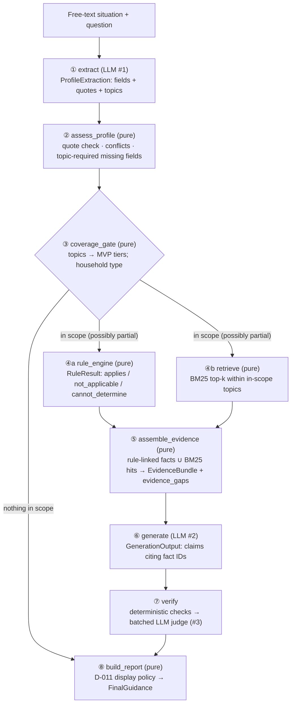

# BTO Buddy — Architecture (approved implementation design)

**Status: APPROVED on 2026-10-28** (decisions D-030 to D-040, with justification and scope
check in [decisions.md](decisions.md)). It came out of the pre-implementation architecture
review, which replaced the held draft (D-029).

- The contracts in §5 are approved **as a shape**. Field-level details are finalised with the
  Phase 2 facts schema (Q-22).
- Items once marked **[APPROVAL Ax]** are now approved, and map to D-030 to D-040 (§14).

**Inputs:** [01 scope](project_context/01_problem_and_scope.md),
[03 data](project_context/03_data_and_licensing.md),
[04 architecture](project_context/04_architecture.md),
[05 evaluation](project_context/05_evaluation.md),
[register](project_context/requirements_register.md),
[decisions](decisions.md).

---

## 1. Recommendation in one paragraph

Build a **single, linear, typed pipeline** in plain Python. Each request runs a fixed
sequence:
1. **one LLM call** extracts the applicant profile and the question topics, with quotes as
   evidence;
2. **deterministic code** assesses the profile, applies the coverage gate, evaluates rules and
   retrieves facts with **BM25 over the ~50–150 authored facts**;
3. **one LLM call** generates cited claims;
4. **verification** runs a deterministic layer plus **one batched LLM judgement call**;
5. a **pure function** assembles the report and applies the D-011 display policy.

Every stage boundary is a Pydantic model. Configurations A–D are the same pipeline with stages
switched off, and all four emit the same output contract. There are no agents, no vector
database, no embeddings and no reranker. Each is held back behind a measurable trigger (§4).

## 2. Requirements that shape the design

| Driver | IDs |
|---|---|
| Three capabilities: retrieve, generate profile-specific guidance, verify | REQ-ARC-001 |
| Fixed pipeline, deterministic validation, no agents/frameworks/vector DB | REQ-ARC-002, REQ-ARC-003, BD-09 |
| Coverage gate before generation | REQ-ARC-004, REQ-SCP-005 |
| Four distinct contract fields | REQ-ARC-005, REQ-SCP-013, REQ-ARC-013, REQ-ARC-014 |
| Typed objects between modules | REQ-ARC-007 |
| Facts KB only at runtime; rules cite fact IDs | REQ-DAT-010..012, REQ-DAT-015 |
| Verifier outcomes and display policy | REQ-VER-001..007, D-011 |
| Same model, instructions and labels across A–D; C→D reuse | REQ-EVL-010..012 |
| Reproducible runs and offline rescoring | REQ-DAT-018, REQ-NFR-001 |
| Free tier, operational model justification | REQ-NFR-004, REQ-MOD-001 |

## 3. End-to-end architecture



### 3.1 Stages

| # | Stage | LLM? | Input → Output | Notes |
|---|---|---|---|---|
| ① | `extract` | Yes | `UserRequest` → `ProfileExtraction` | Structured output. Every non-null field carries a **verbatim quote** from the input. Also tags question topics from a closed enum |
| ② | `assess_profile` | No | `ProfileExtraction` → `ProfileAssessment` | **Quote guard:** a field whose quote isn't a substring of the input is discarded and logged as an extraction warning (anti-hallucination). Detects conflicts. Computes missing fields **only for the topics asked about** |
| ③ | `coverage_gate` | No | topics + assessment → `CoverageDecision` | Deterministic topic→tier map (D-008). An unsupported household type is out of scope (default for Q-05). Mixed questions continue with the in-scope part |
| ④a | `evaluate_rules` | No | profile + rules → `list[RuleResult]` | **Tri-state.** `cannot_determine` lists the missing fields it needs. Rules produce preparation steps and flags, **never eligibility verdicts** |
| ④b | `retrieve` | No | query (question + topic terms) → `list[Evidence]` | BM25 restricted to in-scope topic facts; top-k |
| ⑤ | `assemble_evidence` | No | rule results + hits → `EvidenceBundle` | Facts cited by applicable rules are **always included**, so recall on required rules doesn't depend on BM25. Raises `evidence_gaps` when an in-scope topic has no evidence |
| ⑥ | `generate` | Yes | profile assessment + rules + evidence → `GenerationOutput` | Atomic claims, each citing fact IDs from the bundle only. Missing fields and conflicts are **passed in, not re-derived** |
| ⑦ | `verify` | Deterministic + 1 LLM | claims + bundle → `list[VerificationResult]` | **Deterministic layer first** (a hit decides the outcome, no LLM): no citation → insufficient; citation not in bundle → insufficient; contradicts a deterministic rule result → contradicted. Remaining claims go to **one batched entailment judgement** (supported / contradicted / insufficient) |
| ⑧ | `build_report` | No | everything → `FinalGuidance` | Applies D-011: supported → shown with source; contradicted → withheld and flagged; insufficient → stated as unconfirmed, with the gap |

- **LLM calls per request:** ① + ⑥ + ⑦ = **3** in config D, **2** in C, **1** in A and B.
- **Out-of-scope requests stop after ③:** 1 call, and the report is the redirect.

### 3.2 Configurations A–D from one pipeline (REQ-EVL-010..012)

| Stage | A Direct LLM | B RAG | C Hybrid | D Hybrid + verifier |
|---|---|---|---|---|
| ①–③ profile, gate | — (LLM does it inside ⑥) | — | ✓ | ✓ (reused from C) |
| ④a rules | — | — | ✓ | ✓ (reused) |
| ④b/⑤ retrieval | — | BM25 on raw question | ✓ | ✓ (reused) |
| ⑥ generate | ✓ | ✓ | ✓ | **C's saved output** |
| ⑦ verify | — | — | — | ✓ |
| Output contract | `FinalGuidance` | `FinalGuidance` | `FinalGuidance` | `FinalGuidance` |

**[APPROVAL A6] Same structured output for every configuration.**
- In A and B, the generation prompt asks the LLM itself to list missing fields, conflicts and
  out-of-scope reasons, in the **same enums** that C and D fill deterministically.
- **Why:**
  - the metrics (missing-information recall, abstention, required-rule recall) can be scored
    identically and automatically;
  - "equivalent task instructions" (D-003) holds;
  - free-text baselines would need manual mapping to the enums for every case.
- **Trade-off:** A becomes a *structured-output* direct LLM rather than a chat-style one. That
  is a stronger, fairer baseline, but slightly less like a "conventional assistant". The README
  must say so.
- **Alternative:** free-text A and B, scored by manual annotation. Slower, and less
  reproducible.

**Single-turn interaction [APPROVAL A8].** Follow-up questions are *outputs*. The user
answers by resubmitting with more detail. There is no conversation memory. Benchmark cases
are single-turn.

## 4. Approach comparisons

### 4.1 Rules + BM25 pipeline vs agentic vs vector-database designs

| Criterion | **Rules + BM25 pipeline (recommended)** | Agentic (tool-calling LLM decides when to retrieve, check rules, ask) | Vector DB RAG (embeddings + Chroma/FAISS/pgvector) |
|---|---|---|---|
| Task fit | Fixed, known steps; small closed corpus; deterministic hard rules | Suits open-ended tasks with variable steps; this task's steps are fixed | Suits large or paraphrase-heavy corpora; ours is ~100 authored facts |
| Evaluability | Each stage has typed I/O and can be scored alone. Clean A–D ablation | Control flow varies per run, so component attribution and ablation get murky | Adds an embedding-model variable to every result |
| Determinism and reproducibility | Only 3 LLM calls, all cached | Variable number of calls; loops; harder to cache | Index depends on the embedding model version |
| Latency and cost | 3 calls, bounded | Unbounded calls; more tokens per step | +1 embedding call, or a local model |
| Safety in a consequential domain | Rules can't be "skipped" by the model | Model may skip a rule check or retrieval | Same as RAG |
| Dependencies | pydantic, pyyaml, BM25 lib | Agent framework (forbidden by REQ-ARC-002) | Vector store + embedding stack (torch ≈ 2 GB image, or an API) |
| Assessment alignment | Matches the approved design; justifies complexity through ablation | Conflicts with REQ-ARC-002 / BD-09 | "Unnecessary vector databases" are excluded (REQ-ARC-002) |

**Verdict:** the rules + BM25 pipeline. Neither alternative gives a testable benefit at this
corpus size, and both are excluded by approved decisions.

### 4.2 Retrieval methods

| Method | Strength | Weakness for this corpus | Cost |
|---|---|---|---|
| **BM25 (recommended)** | Exact matching on policy vocabulary (HFE, FT(PMC), "occupier", "core occupier", "nine months"); explainable scores; deterministic; zero model dependency; sub-millisecond on ~100 docs | Lexical mismatch: "fiancée" vs "fiance", "BTO" vs "new flat", colloquial questions | ~0 |
| Semantic (dense embeddings) | Paraphrase matching | Weak on acronyms and numbers; needs torch (≈2 GB image, slow cold start) or an embedding API (another provider, data leaves); version drift | Medium |
| Hybrid (BM25 + dense, RRF) | Best of both on large, varied corpora | Both dependencies; tuning a fusion weight on ~100 docs overfits the dev set | Medium–high |
| Reranking (cross-encoder or LLM) | Precision at top ranks | Precision isn't the bottleneck: rule-linked facts are always included and k can be generous (~8 facts ≈ 600 tokens). An LLM reranker adds a call | Medium–high |

**Recommendation: BM25 only**, with three cheap, deterministic mitigations for its known
weakness:
1. **A curated `aliases` field on each fact**, indexed with the statement (e.g. "HDB Flat
   Eligibility", "HFE letter"; "fiance", "fiancée", "fiancé"). **[APPROVAL A2]**, a one-field
   schema addition to 03 §2.5.
2. **A topic filter:** search only facts whose topic passed the gate.
3. **Rule-linked facts always included** (stage ⑤).

**Testable trigger for anything more:**
- On the **dev** retrieval queries, if recall@5 falls below 0.90, *and* error analysis
  attributes the misses to paraphrase rather than coverage gaps, propose dense or hybrid
  retrieval as a decision, with before/after recall@k.
- Otherwise, don't build it.

**Alternative considered and not recommended: put the whole KB in the prompt.** At ~100 facts,
it fits in context and removes retrieval failure. But it:
- removes the explicit evidence set that the verifier and citations depend on;
- scales badly;
- inflates per-call cost;
- turns config B into something other than RAG.

**Implementation choice:** `rank-bm25` (small, pure Python, numpy only). The alternative is
about 50 lines in-house; recommended only if you prefer zero dependencies.
Tokeniser: lowercase, alphanumeric tokens, numbers kept, a small stop-word list, no stemming
library.

## 5. Pydantic contracts (proposed; finalised with the Phase 2 facts schema, Q-22)

Field names are indicative. Enumerations that depend on verified policy (employment
categories, topics) are confirmed in Phase 2.

```python
# ---- shared enums -------------------------------------------------------------
class Tier(StrEnum): CORE="core"; LIMITED="limited"; CONTEXT="context"; EXCLUDED="excluded"

class Topic(StrEnum):
    # in scope (tier fixed by D-008)
    HOUSEHOLD_COMPOSITION="household_composition"          # core
    APPLICATION_REQUIREMENTS="application_requirements"    # core
    HFE_PROCESS="hfe_process"                              # core (prerequisites, timing, validity)
    HFE_DOCUMENTS="hfe_documents"                          # core (incl. income/employment docs, D-013)
    PRIORITY_CONSIDERATIONS="priority_considerations"      # limited
    NON_SELECTION="non_selection"                          # limited
    HFE_GRANT_LOAN_CONTEXT="hfe_grant_loan_context"        # context only
    # excluded (D-008)
    GRANT_LOAN_CALCULATION="grant_loan_calculation"
    FINANCING_AFFORDABILITY="financing_affordability"
    BALLOT_ODDS="ballot_odds"
    POST_PURCHASE="post_purchase"
    ELIGIBILITY_DETERMINATION="eligibility_determination"
    OTHER_HOUSING="other_housing"                          # resale, rental, EC, etc.
    UNRELATED="unrelated"

TOPIC_TIER: dict[Topic, Tier]   # single source of truth for the gate, unit-tested

class ProfileField(StrEnum):    # addressable fields, for missing/conflict reporting
    RELATIONSHIP="relationship"; A1_AGE="applicant_1.age"; A2_AGE="applicant_2.age"
    A1_CITIZENSHIP="applicant_1.citizenship"; A2_CITIZENSHIP="applicant_2.citizenship"
    A1_PRIOR_HOUSING="applicant_1.prior_flat_or_subsidy"; A2_PRIOR_HOUSING="applicant_2.prior_flat_or_subsidy"
    A1_EMPLOYMENT="applicant_1.employment"; A2_EMPLOYMENT="applicant_2.employment"
    HFE_STATUS="hfe_status"; HFE_ISSUE_DATE="hfe_issue_date"
    PRIVATE_PROPERTY="private_property_interest"; HOUSING_LOAN_INTENT="housing_loan_intent"
    CHILDREN="children_or_expecting"

# ---- request / profile ------------------------------------------------------------
class UserRequest(BaseModel):
    request_id: str
    situation_text: str          # free text; fictional profiles only (UI warns)
    question: str

class Person(BaseModel):
    age: int | None = Field(None, ge=0, le=120)
    citizenship: Literal["SC", "SPR", "non_resident"] | None = None
    prior_flat_or_subsidy: bool | None = None      # drives first-timer status
    employment: Literal["unemployed", "full_time_nsf", "full_time_student", "employed_with_cpf",
                        "employed_without_cpf", "self_employed"] | None = None  # S07 statuses (D-062)
    job_count: int | None = Field(None, ge=0)      # jobs in the assessment period (D-062)

class ApplicantProfile(BaseModel):
    """None = not provided. Never defaulted (REQ-ARC-013)."""
    relationship: Literal["married", "engaged", "other"] | None = None
    applicant_1: Person = Person()
    applicant_2: Person = Person()
    hfe_status: Literal["not_started", "preliminary_done", "applied", "issued"] | None = None
    hfe_issue_date: date | None = None
    private_property_interest: bool | None = None
    housing_loan_intent: Literal["hdb", "financial_institution", "undecided"] | None = None
    children_or_expecting: bool | None = None

class FieldQuote(BaseModel):
    field: ProfileField
    quote: str                    # verbatim span from situation_text

class StatedContradiction(BaseModel):
    field: ProfileField
    quotes: list[str] = Field(min_length=2)

class ProfileExtraction(BaseModel):            # LLM #1 output (schema-constrained)
    profile: ApplicantProfile
    quotes: list[FieldQuote]
    stated_contradictions: list[StatedContradiction]
    question_topics: list[Topic] = Field(min_length=1)

# ---- the four distinct signals -------------------------------------------------------
class MissingProfileField(BaseModel):
    field: ProfileField
    needed_for: list[str]         # topic values and/or rule_ids
    follow_up_question: str       # from a static template map (deterministic)

class ProfileConflict(BaseModel):
    fields: list[ProfileField]
    kind: Literal["stated_contradiction", "logical_inconsistency"]
    detail: str                   # e.g. "engaged, but described as spouse"
    quotes: list[str]
    clarification_question: str

class EvidenceGap(BaseModel):
    topic: Topic | None
    claim_id: str | None = None
    kind: Literal["no_evidence_for_topic", "claim_uncited", "claim_unsupported", "fact_temporally_uncertain"]
    detail: str
    official_source_url: str | None = None      # where to confirm

class OutOfScopeReason(BaseModel):
    code: Literal["excluded_topic", "unsupported_household_type", "unrecognised_question"]
    topic: Topic | None = None
    detail: str
    redirect_url: str | None = None             # official service/page

class ProfileAssessment(BaseModel):
    profile: ApplicantProfile                   # after quote guard
    missing_profile_fields: list[MissingProfileField]
    profile_conflicts: list[ProfileConflict]
    extraction_warnings: list[str]              # dropped unquoted fields, etc.

# ---- gate --------------------------------------------------------------------------
class CoverageDecision(BaseModel):
    status: Literal["in_scope", "partially_in_scope", "out_of_scope"]
    supported_topics: list[Topic]
    out_of_scope_reasons: list[OutOfScopeReason]

# ---- knowledge, rules, evidence --------------------------------------------------------
class PolicyFact(BaseModel):     # per 03 §2.5 (+ aliases, A2); loaded, never LLM-produced
    fact_id: str; statement: str; topic: Topic; scope_tier: Tier
    aliases: list[str] = []
    applies_to: dict[str, str] = {}; exceptions: list[str] = []
    source_id: str; source_url: HttpUrl; section: str
    retrieved_at: date; effective_from: date | None; effective_to: date | None
    validation: Validation; critical: bool      # runtime filter is PolicyFact.usable() (D-058)
    kb_version: str

class RuleResult(BaseModel):
    rule_id: str; rule_version: str
    status: Literal["applies", "not_applicable", "cannot_determine"]
    preparation_step: str | None                # only when status == "applies"
    source_fact_ids: list[str] = Field(min_length=1)
    missing_fields: list[ProfileField] = []     # required when cannot_determine
    requires_human_review: bool
    kind: Literal["preparation", "caution", "evidence_gap"]   # D-062
    notes: list[str] = []                       # exception / interpretation notes (D-062)

class Evidence(BaseModel):
    fact_id: str; statement: str; source_url: HttpUrl; section: str
    origin: Literal["rule", "bm25"]
    bm25_score: float | None = None; rank: int | None = None

class EvidenceBundle(BaseModel):
    items: list[Evidence]
    query: str; k: int; kb_version: str
    evidence_gaps: list[EvidenceGap]

# ---- generation and verification ---------------------------------------------------------
class GeneratedClaim(BaseModel):
    claim_id: str
    text: str
    kind: Literal["policy_fact", "preparation_step", "caveat"]   # caveat = not checkable
    cited_fact_ids: list[str]

class GenerationOutput(BaseModel):              # LLM #2 output
    summary: str
    claims: list[GeneratedClaim]
    # Filled by the LLM only in configs A/B (same enums), from upstream in C/D (A6)
    missing_profile_fields: list[MissingProfileField] = []
    profile_conflicts: list[ProfileConflict] = []
    out_of_scope_reasons: list[OutOfScopeReason] = []

class VerificationResult(BaseModel):
    claim_id: str
    outcome: Literal["supported", "contradicted", "insufficient_evidence"]
    method: Literal["deterministic", "llm_judge"]
    checked_fact_ids: list[str]
    rationale: str
    display_action: Literal["show_with_source", "withhold_and_flag", "state_as_unconfirmed"]  # D-011

# ---- final output ------------------------------------------------------------------------
class DisplayedClaim(BaseModel):
    claim: GeneratedClaim
    verification: VerificationResult | None     # None in A–C (no verifier)
    sources: list[HttpUrl]

class RunMetadata(BaseModel):
    config_id: Literal["A", "B", "C", "D"]
    model_id: str; prompt_versions: dict[str, str]; temperature: float
    kb_version: str; rules_version: str
    llm_calls: int; input_tokens: int; output_tokens: int; latency_ms: int
    cache_hits: int

class FinalGuidance(BaseModel):
    request_id: str
    coverage: CoverageDecision
    summary: str
    claims: list[DisplayedClaim]
    preparation_steps: list[RuleResult]         # applies-only, C/D
    missing_profile_fields: list[MissingProfileField]
    profile_conflicts: list[ProfileConflict]
    evidence_gaps: list[EvidenceGap]
    out_of_scope_reasons: list[OutOfScopeReason]
    visual_resources: list[VisualResourceLink]  # from visual_resources.json; display-only
    policy_period: str                          # D-021, e.g. "sources retrieved YYYY-MM-DD"
    disclaimer: str                             # not an official eligibility assessment
    run: RunMetadata
```

**Contract invariants**, unit-tested:
- Every `cited_fact_id` exists in the KB.
- A `RuleResult` with `cannot_determine` has a non-empty `missing_fields`.
- A `withhold_and_flag` claim's text never appears in the rendered guidance.
- `FinalGuidance` always carries all four signal lists, even when they are empty.

## 6. The four signals are distinct by construction (REQ-ARC-005, REQ-SCP-013)

| Signal | Produced by | Trigger | User-facing behaviour | Blocks | Evaluated by |
|---|---|---|---|---|---|
| `missing_profile_fields` | ② `assess_profile` (deterministic: fields required by the asked topics ∪ rules that returned `cannot_determine`) | A required field is `None` | Targeted follow-up question (static template). Guidance stays conditional | Only the rules and steps that need the field | Missing-information recall |
| `profile_conflicts` | ② stated contradictions (LLM, quote-verified) + logical checks (deterministic, e.g. "engaged" yet "my wife"; first-timer yet prior flat stated) | Incompatible values | Ask for clarification. **No guidance that depends on the conflicting field** | Rules using those fields | Conflicting-information category |
| `evidence_gaps` | ⑤ (in-scope topic with no evidence), ⑦ (claim uncited or unsupported) | Missing **policy** evidence | "We can't confirm X from our sources. Check [official page]." Never read as "requirement doesn't exist" (REQ-ARC-014) | Definitive statements on that point | Abstention metric; failure taxonomy (05 §8) |
| `out_of_scope_reasons` | ③ gate | Excluded topic, unsupported household, unrecognised question | Redirect to the official service; the in-scope part is still answered | Generation for those topics | Out-of-scope category; abstention / over-abstention |

Category A (applicant) vs category B (corpus) from 01 §7 maps to `missing_profile_fields` /
`profile_conflicts` vs `evidence_gaps`. The two never share a list.

## 7. Data dependencies

| Dependency | Produced in | Needed by | Status |
|---|---|---|---|
| `data/policy_facts.jsonl` | Phase 2b: 89 facts authored (`kb-2026-10-28.1`, candidate; data_sources §12–§16) | ④b ⑤ ⑦ ⑧ | **Blocking.** Nothing meaningful runs without it. Contracts and tests use a tiny **synthetic test KB in `tests/fixtures/`**, clearly fictional |
| `data/policy_rules.yaml` | Phase 2b: 24 rules (`rules-2026-10-29.1`, D-062 approved; data_sources §19) | ④a | Blocking for C/D |
| `data/sources_manifest.json` | Phase 2 | facts loader (URL resolution) | Blocking |
| `data/visual_resources.json` | Phase 2 | ⑧ | Optional |
| Topic→required-fields map; follow-up templates | Phase 2 (code constants or YAML) | ② | Small, reviewable |
| Prompt templates (versioned) | Phase 3 | ① ⑥ ⑦ | Version ID recorded per run |
| Benchmark, split, claim set, retrieval queries | Phase 3 (after facts) | eval | Labels cite fact IDs |
| LLM API key (env var) | Developer / reviewer | ① ⑥ ⑦ live runs only | Never committed; passed to Docker via `--env-file` |

**Rules representation [APPROVAL A9].** `policy_rules.yaml` uses **declarative conditions**
with whitelisted operators (`eq`, `ne`, `lt`, `gte`, `in`, `is_null`, `all`, `any`), read by a
~60-line interpreter.
- There is **no `eval` and no code in YAML**. Rules stay reviewable as data, and the
  interpreter is exhaustively unit-tested.
- **Alternative:** Python functions per rule. Simpler to write, but it mixes policy into code.

## 8. Privacy and licensing in the design

- **Fictional data only:**
  - the UI shows a banner: "Do not enter real personal information";
  - user text is **not logged** by default;
  - the response cache is used only by eval runs on fictional cases.
- **Provider data terms:** some free tiers allow providers to use inputs for training. That's
  acceptable for fictional benchmark data, **not** for real applicants. Record it as a
  deployment risk (REQ-PRIV-010) and as a model-selection criterion (Q-13: add privacy to the
  scorecard).
- **Licensing:**
  - the runtime reads only authored facts;
  - the HDB pages are linked, not reproduced;
  - infographics and videos are links only (REQ-SRC-010/011);
  - `data/private_corpus/` is never imported. A unit test asserts that no runtime module
    references the path.
- **Secrets:** API keys come from the environment only; there's a `.env.example` with
  placeholder names; the pre-push scan from CLAUDE.md applies.

## 9. Failure modes and uncertainty handling

| Failure | Mitigation | Detected by |
|---|---|---|
| Extraction hallucinates a field | Quote-substring guard drops it; warning recorded | Unit tests; benchmark missing-info and conflict categories |
| Extraction misses a stated field | The field shows as missing, and a follow-up is asked (safe failure) | Missing-information recall (false positives visible) |
| Topic mis-tagged as out of scope | Over-abstention reported; topic enum descriptions in the prompt | Over-abstention rate; out-of-scope category |
| Topic mis-tagged as in scope (should be excluded) | The rule engine has no calculation rules; prohibited-conclusion labels catch it | Critical-error rate |
| BM25 misses a relevant fact | Rule-linked facts are always included; aliases; topic filter | Retrieval recall@k on dev queries |
| Generator cites a fact outside the bundle, or no fact | Deterministic verifier → insufficient | Unit tests; unsupported-claim rate |
| Generator gives an eligibility verdict | Prompt prohibits it; verifier flags; the report never prints a determination | Critical-error rate |
| Verifier approves a claim supported only superficially (missing exception) | Exceptions stored on facts and passed to the judge; claim-set "dropped exception" items | Verifier false-approval rate |
| Verifier false alarms | Insufficient claims are shown as unconfirmed rather than deleted; the cost is measured | False-alarm rate; human-review burden (Q-16) |
| Generator and verifier share a misunderstanding (same model) | **[APPROVAL A5]**: allow the judge to be a different model family if the free tier allows; the deterministic layer runs first | Verifier claim set |
| Malformed structured output | Pydantic validation → **one** bounded retry with the error message → fail closed with an error report | Integration test with a fake client |
| API rate limit or outage | Bounded retry with backoff; response cache; graceful error in the UI | Integration test |
| Stale policy | Policy period and retrieval date in every report; disclaimer | Acceptance check |
| Prompt injection in user text | User text is delimited as data; no tools to hijack; output is schema-constrained; the gate is deterministic | Small adversarial dev cases (optional) |
| Non-determinism between runs | Temperature 0; cache keyed by (model, prompt version, inputs, params); saved predictions | Offline rescoring reproduces scores |

**Uncertainty is categorical, never numeric:**
- LLM self-reported confidence scores are uncalibrated, so they aren't used.
- Uncertainty is carried by:
  - tri-state rules;
  - verifier outcomes;
  - `evidence_gaps`;
  - partial-scope status;
  - the policy period.

## 10. Evaluation opportunities (beyond the approved end-to-end metrics)

| Component | Metric | Labels needed | Status |
|---|---|---|---|
| ② extraction + assessment | Field-level precision/recall of the extracted profile; missing-field recall | Gold profile per scenario (cheap: authored with the scenario) | **Optional diagnostic, [APPROVAL A11]** |
| ③ gate | In/out-of-scope confusion matrix | Already in the benchmark labels | Free |
| ④a rules | 100% via table-driven unit tests | None | Planned |
| ④b retrieval | Recall@k on dev and held-out queries | Gold fact IDs (approved) | Approved |
| ⑦ verifier | Approved claim-set metrics; deterministic layer vs judge contribution | Claim set (approved) | Approved |
| End to end | D-004 primary and supporting metrics, by configuration and category | Benchmark | Approved |

## 11. Dependencies and module boundaries

### 11.1 Minimal dependency list [APPROVAL A7]

| Package | Group | Justification | Replaces / instead of |
|---|---|---|---|
| `pydantic` | runtime | Contracts and structured-output validation (already present) | — |
| `pyyaml` | runtime | Rule registry format (D-022) | — |
| `rank-bm25` | runtime | Standard BM25Okapi, pure Python | Vector DB / embeddings |
| `openai` | runtime | **OpenAI-compatible client.** Groq, OpenRouter, Gemini's compatible endpoint, Together, Cerebras and Ollama all expose this API, so changing provider or model is configuration, not code. Gives timeouts and retries. Doesn't commit us to OpenAI as a provider | Several provider SDKs |
| ~~`playwright`~~ | ~~opt-in `capture` group (D-042)~~ | **Removed (D-056).** HDB blocks automated clients, so capture is manual (D-055) | Manual rendered-DOM capture in a browser |
| `streamlit` | runtime (app) | Quick Python-native demo UI (Q-23) | FastAPI + frontend |
| `pytest`, `ruff`, `mypy`, `types-PyYAML` | dev | Tests, lint, strict typing | — |

**Not needed:**
- `pandas` and `scikit-learn`: the metrics are counts and ratios; bootstrap and exact
  McNemar are about 30 lines of stdlib (`random`, `math.comb`).
- `pydantic-settings`: config is a small Pydantic model read from the environment.
- LangChain, LlamaIndex, agent frameworks, vector stores, `torch`.

This drops two items from the PROPOSED stack row in 04 §6.1.

### 11.2 Repository layout and dependency direction (D-041, supersedes the D-030/D-039 layout)

The developer's recommended structure, simplified so that no module exists only for show.
Files are created when they get real content, never as empty stubs.

```
src/bto_buddy/
  app.py            # Streamlit entry point (thin: calls pipeline, renders FinalGuidance)
  schemas.py        # all Pydantic contracts and enums from §5; imports nothing from the package
  policy.py         # pure policy domain: load/validate facts, manifest, visual resources;
                    #   declarative rule interpreter; TOPIC_TIER gate; profile assessment
                    #   (quote guard, conflicts, topic-scoped missing fields, follow-up templates)
  retrieval.py      # tokenizer, BM25 index, topic-filtered search, evidence assembly (pure)
  llm.py            # LLMClient protocol, OpenAI-compatible client, disk cache, call accounting
  generation.py     # LLM #1 extraction and LLM #2 generation (prompts + output validation)
  verification.py   # deterministic checks + batched LLM judge; D-011 display actions
  pipeline.py       # run(request, config_id): composes A–D; builds FinalGuidance
  prompts/          # versioned prompt text (extract_v1.md, generate_v1.md, verify_v1.md)
evaluation/
  run.py            # CLI: run configs on dev/test, save predictions, re-score offline
  metrics.py        # D-004 metrics, retrieval recall@k, verifier metrics, bootstrap/McNemar
  metric_spec.md    # frozen operational definitions (written before the held-out run)
  results/<run_id>/ # run_metadata.json, predictions.jsonl, scores.json (tracked)
scripts/            # Phase 2 developer tooling, stdlib only; not used at runtime or in Docker
  snapshots.py      # audit + register manually captured sources (D-055, D-056)
  corpus.py         # extract L1 passages, validate completeness, check/verify facts, freeze (D-059)
tests/              # test_policy.py, test_retrieval.py, test_verification.py,
                    # test_pipeline.py, test_smoke.py
```

**Simplifications versus the recommended structure, with reasons:**

| Recommended item | Change | Reason |
|---|---|---|
| — | **Added `llm.py`** | Three modules (`generation`, `verification`, and extraction inside `generation`) share one client. A separate module is the single seam where tests inject a fake and where caching and token accounting live. Without it, `verification` would import from `generation` |
| `evaluation/baselines.py` | **Dropped** | D-030: configurations A–D are the same pipeline with stages switched off, so they live in `pipeline.py`. A separate baselines module would duplicate prompt logic and break "equivalent instructions" (D-003) |
| Separate retrieval-query file | **Dropped** | Retrieval recall@k uses each benchmark case's gold fact IDs. One labelled source, no duplication |
| `contracts.py`, `knowledge.py`, `rules.py`, `gate.py`, `profile.py`, `evidence.py`, `report.py`, `extraction.py` (D-030 layout) | **Merged** into `schemas.py`, `policy.py`, `retrieval.py`, `generation.py`, `pipeline.py` | Each was small. If `policy.py` grows past about 400 lines, split out `profile.py` (recorded as an allowed refactor, no new decision needed) |

**Boundary rules:**
- `schemas`, `policy`, `retrieval` and `pipeline`'s report assembly are pure: they never import
  `llm`.
- Only `generation` and `verification` call the `LLMClient` protocol, so tests inject a fake.
- `pipeline` is the only module that knows about configurations.
- `evaluation/` consumes `FinalGuidance` and saved predictions. It never reaches into stage
  internals, except through the component metrics.
- `scripts/` is never imported by `src/` or used by Docker (REQ-DAT-022).

**Data paths (D-022 + D-041):**

| Content | Path | Git |
|---|---|---|
| Canonical KB | `data/policy_facts.jsonl` | tracked after rights review |
| Rules, manifest, coverage, visual resources | `data/policy_rules.yaml`, `data/sources_manifest.json`, `data/source_coverage.csv`, `data/visual_resources.json` | tracked |
| Benchmark | `data/benchmark_dev.jsonl`, `data/benchmark_test.jsonl` (the held-out set is a physically separate file) | tracked |
| Verifier claim set | `data/verifier_claims_dev.jsonl`, `data/verifier_claims_test.jsonl` | tracked |
| Private source snapshots / derivatives | `data/private_corpus/raw/`, `data/private_corpus/processed/` | **ignored** |
| Run outputs | `evaluation/results/<run_id>/` | tracked (offline re-scoring) |
| LLM cache | `.cache/llm/` | **ignored** |

## 12. Tests

### 12.1 Unit tests (no network; synthetic fixture KB)

| Area | Tests | Requirement IDs |
|---|---|---|
| Contracts | Valid/invalid construction; enum coverage; `cannot_determine` ⇒ missing fields; JSON round-trip | REQ-ARC-005, REQ-ARC-007 |
| Knowledge | Unique fact IDs; every fact's `source_id` resolves in the manifest; unverified facts rejected; **no runtime module references `private_corpus`** | REQ-DAT-010, REQ-DAT-012, REQ-DAT-015 |
| Rules | Each operator; unknown operator rejected; every `source_fact_id` exists; table-driven applies / not_applicable / cannot_determine per rule; no rule emits an eligibility verdict | REQ-DAT-014, REQ-ARC-008, REQ-SCP-004 |
| Profile | Quote guard drops unquoted fields; each logical conflict; missing fields limited to the asked topics; follow-up template exists for every field | REQ-ARC-013, REQ-SCP-013 |
| Gate | Every `Topic` has a tier; excluded → out of scope with redirect; mixed → partial; unsupported household → out of scope | REQ-ARC-004, REQ-SCP-001, REQ-SCP-005 |
| Retrieval | Tokeniser; aliases matched; topic filter; deterministic ordering and tie-breaks | REQ-ARC-010 |
| Evidence | Rule-linked facts always present; dedupe; gap when a topic has no evidence | REQ-ARC-014 |
| Verification (deterministic layer) | Uncited → insufficient; cited outside bundle → insufficient; contradicts rule result → contradicted | REQ-VER-001, REQ-VER-005 |
| Report | D-011 mapping per outcome; withheld text absent; four lists always present; disclaimer and policy period present | REQ-VER-002, REQ-VER-003, REQ-SCP-011 |
| Eval scoring and stats | Hand-computed fixtures per metric, including zero denominators; bootstrap with fixed seed; exact McNemar against known values | REQ-EVL-024..026, REQ-EVL-030 |

### 12.2 Integration tests (fake `LLMClient` with canned JSON; no network)

| Test | Requirement IDs |
|---|---|
| Configs A–D run end to end and all return a valid `FinalGuidance` | REQ-EVL-010 |
| D reuses C's exact pre-verification output (same object hash) | REQ-EVL-012 |
| An out-of-scope request makes **zero** generation calls | REQ-ARC-004 |
| Malformed LLM JSON → one retry → fail-closed report | REQ-VER-003 |
| A cache hit replays without calling the client; `RunMetadata` counts are correct | REQ-DAT-018 |
| A contradicted claim never reaches the displayed output | REQ-VER-007 |

### 12.3 Acceptance tests (developer-run; some need a real model)

| Test | Requirement IDs |
|---|---|
| `docker build` + `docker run` on a clean checkout; app health endpoint responds; no `private_corpus` in the image | REQ-SUB-002, REQ-NFR-001, REQ-DAT-012 |
| The three demo archetypes produce the expected behaviour class (guidance / follow-ups / corrected misconception) | REQ-SCP-014 |
| `eval rescore` on committed predictions reproduces the committed scores **without an API key** | REQ-DAT-018, REQ-NFR-001 |
| README commands executed verbatim | REQ-SUB-001, REQ-DOC-004 |
| Pre-push secret and anonymity scans clean | REQ-SUB-005, REQ-LIC-015 |

## 13. Justification summary

| Choice | Task suitability | Data sensitivity | Latency | Maintainability | Reproducibility | Cost at scale |
|---|---|---|---|---|---|---|
| Linear typed pipeline | Fixed, known steps | No tools to misuse | Bounded (≤3 calls) | One module per stage | Stage outputs saved | Linear in queries |
| Deterministic gate, rules, profile checks | Explicit conditions don't need an LLM (REQ-ARC-008) | No data leaves for these steps | ~0 | Table-tested | Exact | ~0 |
| BM25 + aliases | Small closed corpus, acronym-heavy | Local | Sub-millisecond | Tiny, explainable | Exact | ~0 |
| OpenAI-compatible client | Swap models for comparison | Lets a local Ollama model be chosen if privacy requires | Provider-dependent | One adapter | Model ID recorded; cache | Provider choice remains open |
| Batched judge after deterministic checks | Entailment needs language understanding; cheap checks first | Same as generation | +1 call, measured in C vs D | One prompt | Cached | +1 call; justified only if C vs D shows value (REQ-VER-006) |
| Streamlit | Demo UI in Python | Local | Fine for a demo | Thin layer | Pinned in `uv.lock` | Not a production UI (D-026) |

**Cost at scale:** cost per query ≈ Σ over calls of (input tokens × input price + output
tokens × output price), for 2–3 calls. Token counts are **measured** per run in
`RunMetadata`. The deployment section will compute the figure from measured averages, not from
guesses. Retrieval, rules and gate cost nothing beyond CPU. No GPU is needed.

## 14. Approved decisions (2026-10-28)

The justification and scope-alignment check for each item are recorded in
[decisions.md](decisions.md). None of them overrides an earlier APPROVED decision.

| Review item | Decision | Summary |
|---|---|---|
| A1 | D-030 | 8-stage linear typed pipeline; ≤3 LLM calls; A–D from one pipeline |
| A2 | D-031 | BM25 only (`rank-bm25`) + `aliases` + topic filter + rule-linked facts. Escalation trigger: dev recall@5 < 0.90 attributable to paraphrase |
| A3 | D-032 | Quote-grounded extraction + deterministic quote guard; topic-scoped missing fields; template follow-ups |
| A4 | D-033 | Gate: closed-enum topic tags → deterministic tier map; non-couple household types out of scope (resolves Q-05 by default); partial scope supported |
| A5 | D-034 | Verifier: deterministic layer first, then one batched LLM judge. Judge model decided at model selection. No regeneration |
| A6 | D-035 | All configurations emit the same structured `FinalGuidance`; A/B fill the four signals themselves using the same enums |
| A7 | D-036 | Dependencies as in §11.1; pandas and scikit-learn dropped |
| A8 | D-037 | Single-turn interaction; follow-ups are outputs |
| A9 | D-038 | Declarative YAML rule conditions, whitelisted operators, no `eval` |
| A10 | D-039 | File paths as in §11.2 |
| A11 | D-040 | Optional extraction diagnostic, only if time allows |

**Contracts (§5)** are approved as the shape. Field-level details are finalised with the
Phase 2 facts schema (Q-22).

**Schedule.**
- **Target:** project complete and compliant with every assessment requirement by
  **2026-10-29 07:00**.
- The brief's 12–16-hour effort figure is a *reference only*, not a constraint.
- **Build order** (risk-first, each step leaves a runnable state):
  1. contracts, knowledge, rules, gate, profile (pure, tested);
  2. Phase 2 facts;
  3. configs A and C end to end;
  4. D (verifier);
  5. B;
  6. evaluation;
  7. Docker image;
  8. README, demo and AI logs.
- All four configurations are planned. The REQ-EVL-013 fallback (drop B, with
  documentation) is used only if the deadline is at risk, and the developer must agree first.
