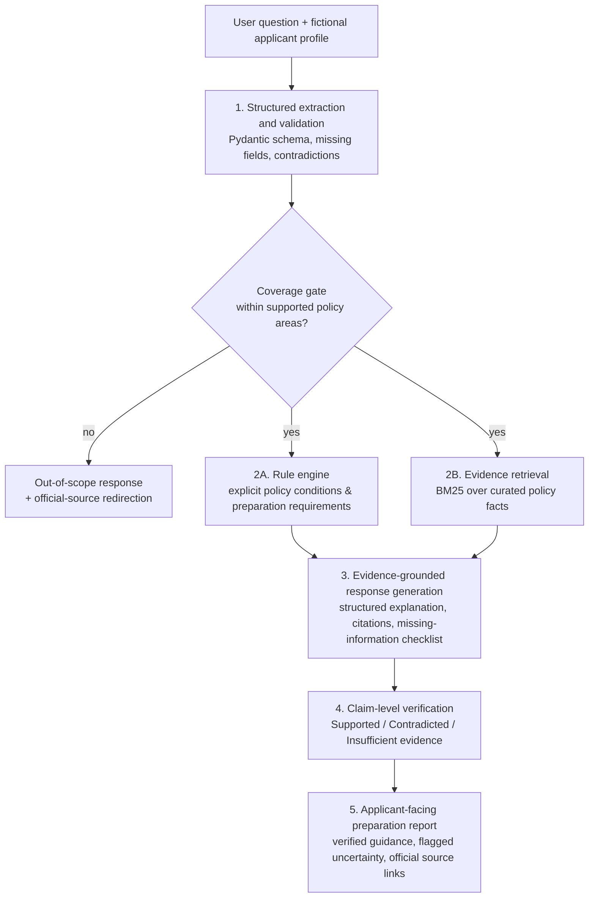

# 04 — Architecture

The legend is in [INDEX.md](INDEX.md#legend).

> No code exists yet. Component names are **planned** identifiers, used for traceability in
> the [requirements register](requirements_register.md).

## 1. Essential capabilities and constraints (APPROVED) [APP p.16–17]

**REQ-ARC-001: the three essential capabilities.**
1. Retrieve authoritative policy evidence.
2. Generate profile-specific preparation guidance, including missing information.
3. Verify factual claims and flag unsupported statements.

**REQ-ARC-002: constraints.**
- Use deterministic Python validation for known structured fields.
- **Avoid** autonomous agents, complex orchestration frameworks and unnecessary vector
  databases (BD-09).

**REQ-PRB-002 tension.** The brief needs *significant AI integration*, not "simply an API
call within a standard web app" [ASM p.2]. The argument that this design meets that bar
rests on:
- LLM-based structured profile extraction;
- grounded generation;
- claim-level verification;
- an ablation (A–D) showing each component's measured contribution.

The README must make this argument explicitly.

## 2. Pipeline — REQ-ARC-003 (APPROVED, BD-04) [APP p.17, image]

Rebuilt from the diagram, with the coverage gate (REQ-ARC-004) placed as specified in
[APP p.21]:

**Retrieval corpus note.** The diagram says "BM25 over curated policy passages". Under D-005,
the retrieval corpus is `data/policy_facts.jsonl`.

**Coverage-gate placement.** The diagram doesn't place the gate. [APP p.21] says it runs
"before generating a response". It is now **APPROVED (D-033)**: it runs after profile
extraction and before rules and retrieval. The full implementation design is in
[../architecture.md](../architecture.md) (D-030 to D-040).

| Stage | Planned component | Status |
|---|---|---|
| 1 | `profile_extractor` (LLM → Pydantic) plus deterministic field validation | APPROVED design |
| Gate | `coverage_gate` | APPROVED |
| 2A | `rule_engine` reading `data/policy_rules.yaml` | APPROVED |
| 2B | `retriever` (BM25) | APPROVED. Embeddings PROPOSED, conditional (§6) |
| 3 | `generator` (one selected LLM) | APPROVED design; model OPEN |
| 4 | `verifier` | APPROVED design; method/model OPEN |
| 5 | `report_ui` | APPROVED design; UI framework PROPOSED |

## 3. Structured missing-information contract — REQ-ARC-005 (APPROVED, BD-06) [APP p.20]

Every response object carries these four fields:

| Field | Meaning | Behaviour |
|---|---|---|
| `missing_profile_fields` | Applicant attributes needed for personalised guidance but not provided | Targeted clarification where appropriate. **Never assume values** (REQ-ARC-013) |
| `evidence_gaps` | Missing or insufficient authoritative policy evidence | **Prevents unsupported definitive conclusions** |
| `profile_conflicts` | Contradictory applicant information | Ask for clarification |
| `out_of_scope_reasons` | Questions or scenarios outside the MVP | Coverage-gate response and redirection |

**REQ-ARC-014:** missing evidence must **never** be read as proof that a requirement doesn't
exist.

## 4. Representation principles (APPROVED) [APP p.22, 28]

- **REQ-ARC-006:** represent policies as conditions, exceptions, effective dates and source
  references in structured metadata, never just as paragraphs.
- **REQ-ARC-007:** use typed objects throughout (retrieved evidence, applicable rules, missing
  fields, verification results). Never pass unstructured text between modules. This enables
  component-level error analysis.
- **REQ-ARC-008: hard rules vs soft guidance.**
  - Clearly documented requirements are checked deterministically. Example: a valid HFE
    letter is needed.
  - Complex interpretations stay **evidence-linked explanations that need official
    confirmation**.
  - Document which decisions are deterministic and which need retrieval or human review.
- **REQ-ARC-009:** LLM answers link to the actual HDB webpages as sources [APP p.13].

## 5. Runtime verification (APPROVED) [APP p.22, 26–28], D-011

| Outcome | Displayed behaviour (D-011) |
|---|---|
| **Supported** | Show the claim with a verified source reference |
| **Contradicted** | Withhold the unqualified claim and flag the contradiction |
| **Insufficient evidence** | No definitive guidance. State the evidence gap or the need for official confirmation |

- **REQ-VER-003:** never silently rewrite. No unlimited verification loops.
  - One controlled regeneration is an **optional improvement** and needs approval
    (REQ-VER-004).
- **REQ-VER-005:** keep *contradicted* separate from *not established*. Treating every
  unsupported claim as false is a methodological error.
- **REQ-VER-007:** the verifier must **withhold, correct or clearly flag** to show a
  reduction in *exposed* errors. If it only labelled claims, its detection ability would be
  measured separately (D-011 makes it act).
- **REQ-VER-006:** don't assume a second LLM verification call is worthwhile. Compare its
  incremental error detection against its added cost and latency [APP p.21, 26].
  - The verifier method and model are OPEN (D-001).
- **Risk [APP p.27]:**
  - an LLM checking an LLM doesn't establish correctness, because both may misread the same
    rule;
  - a verifier can approve a claim on the strength of a superficially relevant passage that
    omits an exception.

  This is why the verifier is evaluated independently ([05 §6](05_evaluation.md)).

## 6. Technology choices

### 6.1 Recommended stack — PROPOSED unless marked [APP p.21, image]

| Component | Recommended approach | Why (as given) | Status |
|---|---|---|---|
| UI | Streamlit | Quick, Python-native demonstration | APPROVED (D-036) |
| Structured profile | Pydantic | Validated input/output contracts | APPROVED (D-030, D-036) |
| Knowledge base | ~~Curated official HTML/text passages~~ → `data/policy_facts.jsonl` | Small, auditable corpus | SUPERSEDED → D-005 |
| Retrieval | ~~BM25 *or* lightweight embeddings~~ → BM25 (`rank-bm25`) + aliases + topic filter + rule-linked facts | Simple and measurable | APPROVED (D-031); embeddings only on the trigger |
| Generation | One selected LLM API, through an OpenAI-compatible client | Avoid unnecessary model orchestration | APPROVED (D-036); model OPEN |
| Verification | Deterministic checks, then a batched LLM judge | Testable assurance layer | APPROVED (D-034); judge model OPEN |
| Rules | ~~Small Python functions~~ → declarative YAML conditions, whitelisted operators | Better than LLM guessing for explicit conditions | APPROVED (D-038) |
| Evaluation | ~~Python, Pandas, scikit-learn~~ → Python stdlib | Reproducible metrics and comparisons | APPROVED (D-036) |
| Deployment | Docker | Meets the assessment requirement | MANDATORY (REQ-SUB-002) |

**REQ-ARC-010 / D-031:** BM25 only. Propose dense, hybrid or reranking retrieval **only if**
dev recall@5 < 0.90 *and* the misses are attributable to paraphrase (retrieval recall@k,
[05 §5](05_evaluation.md)).

**REQ-ARC-011:** use one generation model and no unnecessary orchestration.

### 6.2 LLM API provider comparison — PROPOSED, **preliminary** [APP p.22]

> The rankings are provisional and may be stale. Label them as preliminary, not as verified
> current recommendations (REQ-MOD-010). **No model is selected in Phase 0.**

| Provider | Advantages | Limitations | Assessment (provisional) |
|---|---|---|---|
| Google AI Studio | Free-tier access to selected Gemini models, structured outputs, Python SDK | Rate limits and free-tier data-use considerations | First to test |
| GroqCloud | Fast inference, accessible open-weight models, free-plan limits | Model-dependent capabilities and request limits | Strong alternative |
| OpenRouter | Multiple models through one interface | Provider-specific privacy and availability | Useful fallback |
| Ollama | Local inference, control over input data | Hardware-dependent performance | Only if privacy demands it |

Other permitted resources [ASM p.4][APP p.26, 29]:
- **LLM APIs:** Hugging Face Inference Providers, Cerebras, Together AI.
- **Local inference:** llama.cpp, LM Studio.
- **GPU:** Colab, Kaggle Notebooks, Lightning AI.
- **Weights and data:** Hugging Face, Kaggle.

### 6.3 Model-selection scorecard — PROPOSED [APP p.22–23]

| Criterion | Weight |
|---|---|
| Policy reasoning accuracy | 35% |
| Structured output reliability | 25% |
| Handling uncertainty | 20% |
| Latency | 10% |
| Estimated cost | 10% |

**REQ-MOD-001 (MANDATORY):**
- Justify the final choice on operational grounds: data sensitivity, latency, task fit,
  fine-tuning needs, cost-at-scale economics.
- **Never** on "free, cool, had it lying around" [ASM p.4].
- Local vs API doesn't matter in itself.

**Gap.** The scorecard has no data-privacy criterion, although the brief names privacy as a
valid ground. See Q-13.
